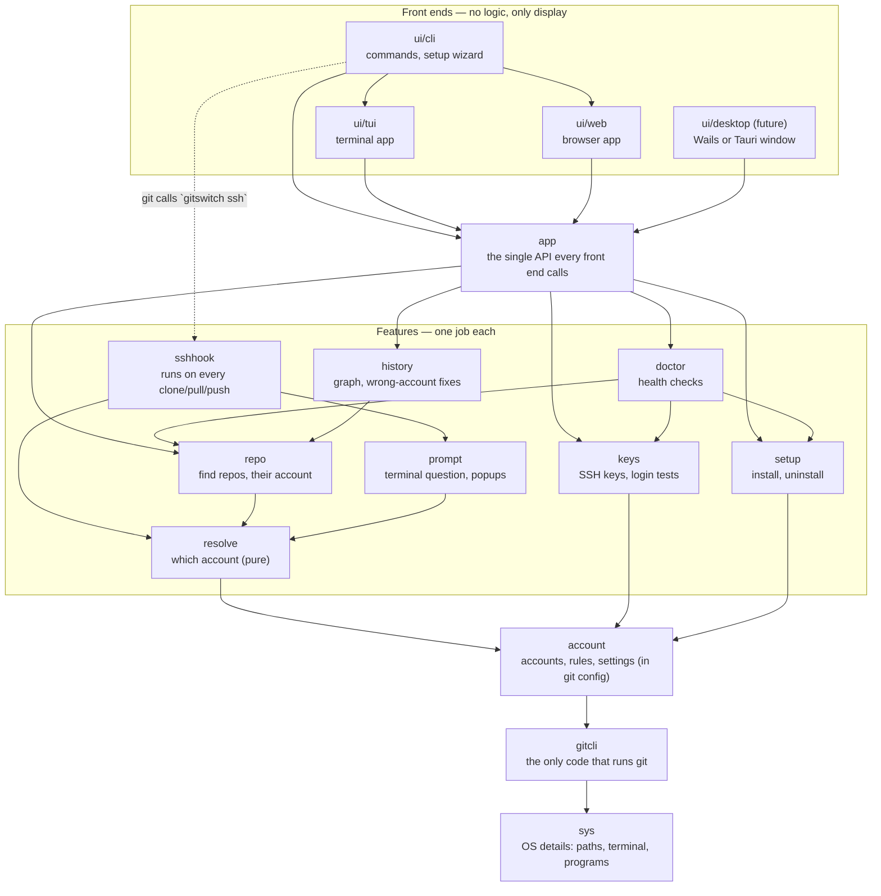

# Architecture

GitSwitch is built in layers. Each layer may use only the layers below it, so
the account core never depends on a screen, and new front ends (a desktop
window, for example) are just another layer on top. The rule is enforced by
`test/architecture`, which fails the build when an import points upward.

## Layers

| Layer | Package | Responsibility |
| --- | --- | --- |
| 0 | `internal/sys` | Operating-system details: paths, terminals and raw keyboard input, starting programs, browser, clipboard, dry-run file changes. The only place with `runtime.GOOS` checks for these. |
| 1 | `internal/gitcli` | Runs the `git` program. Dry-run, hidden console windows and error text are handled here once. Parses remote URLs and hosts. |
| 2 | `internal/account` | Accounts, rules and settings, stored in git config. Validation, rename, per-repo account and identity. |
| 3 | `internal/resolve` | Decides which account a repo uses. **Pure**: no git, no files, so it is fully unit-tested. |
| 3 | `internal/keys`, `internal/setup` | SSH keys and login tests; install and uninstall. |
| 4 | `internal/repo`, `internal/prompt` | Find repos and their account; ask the user (terminal or popup). |
| 5 | `internal/history`, `internal/sshhook` | Commit graph and author fixes; the hook git runs on every network command. |
| 6 | `internal/doctor` | Health checks and repairs. |
| 7 | `internal/app` | The single API for front ends. Returns values and errors; never prints. |
| 8–9 | `internal/ui/*` | Front ends: parse input, call `app`, display results. |
| 10 | `cmd/gitswitch` | `main`: one line that calls `ui/cli`. |

## Rules

1. **Imports point down.** A package imports only lower layers. `test/architecture` enforces it.
2. **Front ends hold no logic.** They call `internal/app` and never import `internal/gitcli`. If a screen needs something new, add an `app` method.
3. **Only `gitcli` runs git**, and only `sys` deals with OS differences.
4. **Core packages never print.** They return values and errors; long operations take a `report func(string)`. Enforced by `test/architecture`. `sshhook` must never write to stdout, because git reads its protocol from it.
5. **No global state.** Settings like dry-run travel in `gitcli.Runner` and `sys.FS`, created once by `app.New`.
6. **Keep decisions pure.** Logic that can be a function of its inputs (like `resolve.Decide`) should be, and gets table tests.
7. **Every new package gets a layer** in `test/architecture/layers_test.go` and in the table above.

## Tests

| Where | What |
| --- | --- |
| `internal/*/..._test.go` | Unit tests next to the code (parsing, decisions, graph layout, key input). |
| `test/integration` | Builds the real program and runs real `git clone/pull/push` through it against local repos via a fake ssh. |
| `test/architecture` | Enforces the layer rules above. |

Run everything with `go test ./...`. CI runs it on Linux, macOS and Windows.

## Future scope: a full git client

GitSwitch can grow into a complete desktop git client (commit graph,
staging, diffs, merges, pull requests) by adding packages in the right
layer. The account core does not change.

| Feature | Where it goes |
| --- | --- |
| Status, staging (files, hunks, lines), commit | Parsers in `gitcli` (`git status --porcelain=v2`, `git diff`), a new `workspace` package in the feature layer, `app` methods. |
| Diff viewer, blame | New `diff` package over `gitcli` parsers. Render only the visible rows. |
| Branches, checkout, stash, tags | `gitcli` parsers + a `refs` feature package. |
| Merge, rebase, conflict editor, cherry-pick, undo | A `merge` package (3-way conflict model) and an `undo` package over the reflog. |
| Pull requests and issues | A `hosting` package (GitHub/GitLab APIs) that uses `account` so each repo talks to its host as the right account. |
| File watching (live refresh) | `sys` (file events) + a `watch` package that tells `app` what changed. |
| Desktop window | `ui/desktop` (Wails), or a Tauri app that runs `gitswitch` as a sidecar and talks to an `app`-backed JSON API like `ui/web`. |

Performance rule for the client: never load or render a whole history or
diff. Stream from `git`, page in the `app` layer, and render only what is on
screen.
