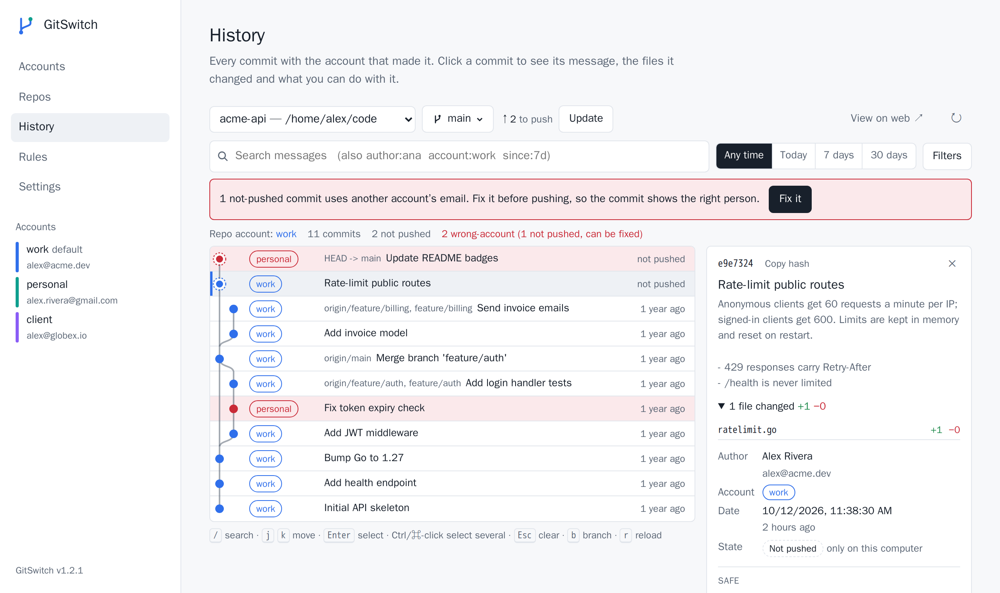
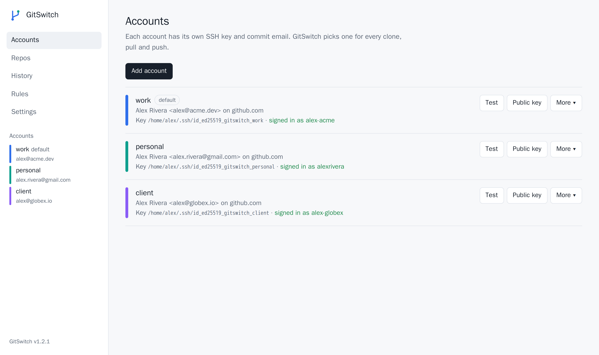
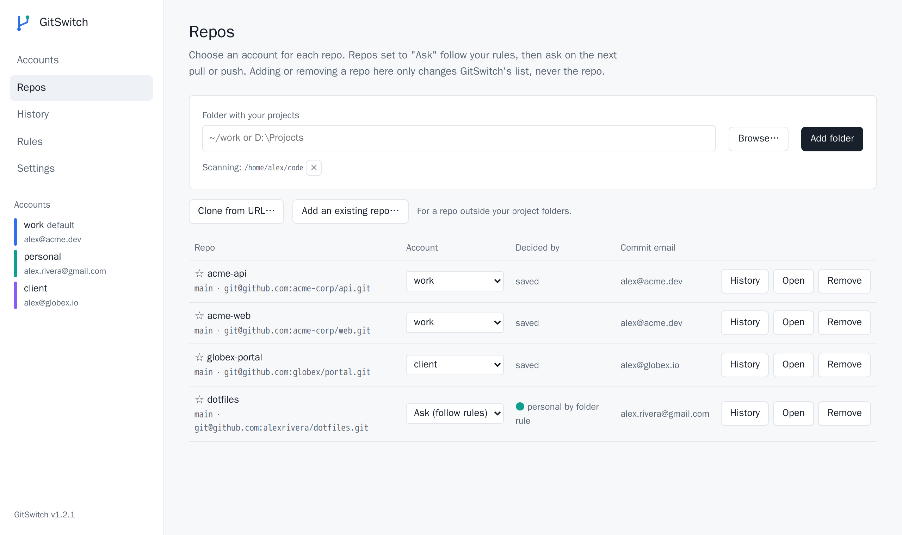
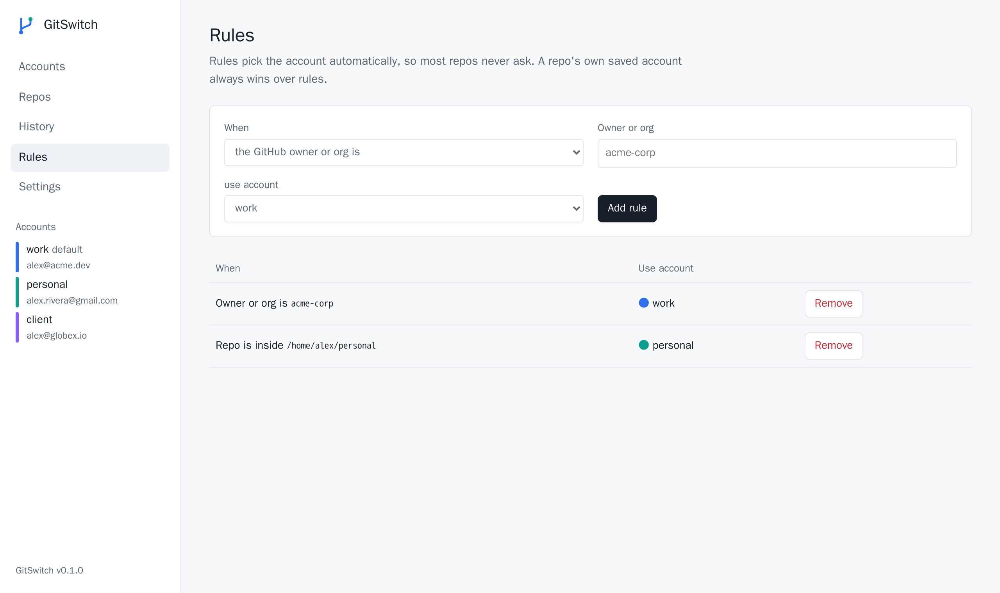
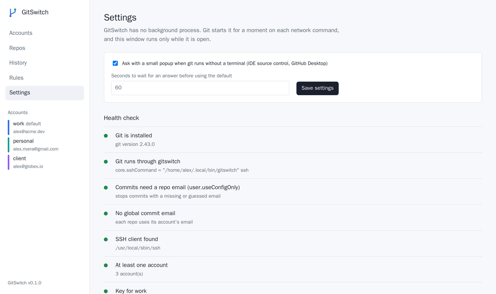

# GitSwitch

[](https://github.com/macdipu/gitswitch/actions/workflows/test.yml)
[](https://github.com/macdipu/gitswitch/releases/latest)
[](go.mod)

[](LICENSE)

**Use several git accounts (work, personal, clients) on one computer with normal clone URLs.**
GitSwitch picks the right SSH key and commit email for every clone, pull and push, in every terminal and IDE.

```
$ git push

Git account for my-company/api?
  1  personal         you@gmail.com
  2  work             you@company.com
Type a number for this time, or add ! to always use it for this repo (e.g. 2!): 2!
gitswitch: work saved for this repo
```

- **One-time install.** One command installs the terminal program and the desktop app on Windows, macOS and Linux. Keeps working after restarts and updates.
- **Nothing running in the background.** Git starts GitSwitch for a moment on each network command (a few milliseconds and about 6 MB of memory, measured on Linux), then it exits.
- **Switch branches without losing work: Park and Smart switch.** Switch with uncommitted changes and GitSwitch asks what to do: take them with you, or park them on their branch until you come back. No stash commands, no half-done state, and Undo if you change your mind.
- **Two front ends, same settings:** a terminal app (`gitswitch`) and a desktop app (`gitswitch ui`).
- **A full git client, with the right account behind every action:** the changes panel and commit box (stage whole files, hunks or single lines; amend; sign off), the commit graph with the account behind every commit, merge with a conflict editor, stashes and parked changes, blame, compare, reflog and bisect, remotes, rebase and reword, worktrees and submodules. Everything that rewrites history asks first, never touches commits that are already pushed, and can be undone.
- **Works everywhere git runs:** Windows Terminal, PowerShell, cmd, macOS Terminal, iTerm, VS Code, Android Studio and other JetBrains IDEs, GitHub Desktop, SourceTree.

<picture>
  <source media="(prefers-color-scheme: dark)" srcset="docs/images/web-history-dark.png">
  
</picture>

## Park and Smart switch

The question every git user meets: *I have uncommitted work, and I need another branch.* GitSwitch asks, and every answer is safe.

```
You have uncommitted changes on feature-login (3 files, 1 new).
  ● Smart switch: take them with me to main
  ○ Park them on feature-login (restored when you come back)
  ○ Cancel
  ☐ Remember my choice for this repo
```

- **Smart switch** takes your changes along. If git can switch with them, it just switches. If not, they are set aside, applied on the new branch, and staged files stay staged. If some files clash with the new branch, you stay on it with those files marked, your original changes are kept safe, and you choose: fix them, **go back** exactly as before, or **park instead**.
- **Park** leaves your changes on their branch, new files included, and switches clean. When you come back, GitSwitch offers them: **Restore**, **Look first**, or **Not now**. Parked changes are ordinary stashes named `gitswitch park: <branch>`, so `git stash list`, IntelliJ and VS Code show them too, and they are never deleted automatically.
- **Nothing is ever half done, and it is all undoable.** A clash never leaves a mix: your changes are either on the new branch or still parked. Other actions wait until you decide, even if you close the app.
- **Ask once, or never.** Tick *Remember my choice for this repo*, or set it for every repo: `gitswitch set switch-changes ask|smart|park`.
- **Everywhere you switch:** the branch menu, double-clicking a branch pill in the log, checking out a commit, the terminal app, and `gitswitch switch <branch> --smart|--park`. Parked changes sit in a bar above the log and in *Stashes…*.

```sh
gitswitch switch main --smart      # take your uncommitted changes along
gitswitch switch main --park       # leave them on this branch until you come back
gitswitch parked                   # what is parked, newest first
gitswitch resolve --done           # after a clash: the files are fixed
```

More in [Commit history and branches](#commit-history-and-branches).


## Contents

- [Park and Smart switch](#park-and-smart-switch)
- [Install](#install)
- [Quick start](#quick-start)
- [How an account is chosen](#how-an-account-is-chosen)
- [Terminal app and desktop app](#terminal-app-and-desktop-app)
- [A full git client at a glance](#a-full-git-client-at-a-glance)
- [IDE notes](#ide-notes)
- [Commit history and branches](#commit-history-and-branches)
- [Repo list](#repo-list)
- [Sign in to your git host](#sign-in-to-your-git-host)
- [Health check](#health-check)
- [Command reference](#command-reference)
- [How it works](#how-it-works)
- [Uninstall](#uninstall)
- [Development](#development)
- [License](#license)

## Install

The installer detects your system, downloads the matching programs (`gitswitch` and the desktop app) from the [latest release](https://github.com/macdipu/gitswitch/releases/latest), verifies their SHA-256 checksums, checks that they start on your system and installs them. On Linux without WebKitGTK it installs only `gitswitch` (see [Terminal app and desktop app](#terminal-app-and-desktop-app)).

**macOS, Linux, WSL, Git Bash**

```sh
curl -fsSL https://raw.githubusercontent.com/macdipu/gitswitch/main/install.sh | sh
```

**Windows (PowerShell)**

```powershell
irm https://raw.githubusercontent.com/macdipu/gitswitch/main/install.ps1 | iex
```

Run the same line again to update. To pin a version, set `GITSWITCH_VERSION=v1.2.0` first.

<details>
<summary>Manual install</summary>

Download `gitswitch-<os>-<cpu>` and, for the desktop app, `gitswitch-app-<os>-<cpu>` for your computer from the [Releases page](https://github.com/macdipu/gitswitch/releases). Rename them to `gitswitch` and `gitswitch-app` (add `.exe` on Windows), put both in one folder and run `gitswitch install`: it installs both. On Windows you can simply double-click `gitswitch.exe`. Run with no command in a terminal, it asks before it connects to git.

</details>

<details>
<summary>With Go</summary>

```sh
go install github.com/macdipu/gitswitch/cmd/gitswitch@latest
gitswitch install
```

This installs the terminal program only. The desktop app needs cgo and build tags; see [Development](#development).

</details>

Then open a **new** terminal.

## Quick start

New to SSH keys? Open the desktop app:

```sh
gitswitch ui
```

The first time, a guided setup connects git, adds your first account, creates its key, shows where to put the key on GitHub, GitLab or Bitbucket, tests the login and asks for your projects folder. If something goes wrong it explains why. Run it again any time from Settings → **Run guided setup**. The terminal app (`gitswitch`) shows the same steps as keys to press when there is no account yet.

Or, in the terminal, answer a few questions:

```sh
gitswitch setup
```

<p align="center"></p>

The wizard connects GitSwitch to git, then for each account:

1. Asks for a short name, the commit name and email.
2. Creates a new SSH key (or uses one you already have) and shows the public key with a link to GitHub's **New SSH key** page.
3. Waits while you add the key, then logs in to check it (`Connected: work is alex-acme on github.com`).
4. Lets you add rules, so most repos never need to ask, and optionally pick a default account (type `none`, or press Enter to keep none).
5. Asks for the folder where you keep your projects, so the apps can list your repos.

Or script it, one command per account:

```sh
gitswitch account add work --email you@company.com --name "Your Name" --key new
gitswitch account add personal --email you@gmail.com --key new
gitswitch key show work --open        # copies the public key, opens GitHub's SSH key page
gitswitch test                        # checks each key logs in, and as whom
gitswitch rule add owner:my-company work
gitswitch rule add folder:~/personal personal
```

Add each public key on GitHub (**Settings → SSH and GPG keys → New SSH key**) while signed in to the matching account.

From then on, clone and push as usual:

```sh
git clone git@github.com:owner/repo.git
```

## How an account is chosen

For each repo, GitSwitch checks in this order and uses the first match:

1. The account saved for the repo (`gitswitch use work`, or ticked when asked). `gitswitch repo clone --account` saves it for the new repo.
2. An **owner rule**: `owner:my-company` matches every repo of that org, even during `git clone`.
3. A **folder rule**: `folder:~/work`.
4. In a terminal, it **asks**. A typo asks again. When git runs several connections at once (`fetch --jobs`, submodules), they ask one at a time.
5. With no terminal (e.g. an IDE's Source Control panel, a background job, or `GIT_TERMINAL_PROMPT=0`), a **small popup** asks.
6. If nobody answers: the **default account**, when you have set one, for that connection only. With no default, git does not connect, so nothing is ever pushed as a guessed account. Nothing hangs waiting for an answer, and ssh's `BatchMode=yes` never asks.

**The default account is optional.** An answer is used for that connection only; it is saved for the repo only when you tick **always use it for this repo** in the popup, or add `!` in a terminal (`2!`). Without a default (the normal case), Enter alone is not an answer. With one, Enter picks it.

| | Set | Remove |
| --- | --- | --- |
| Global default | `gitswitch default work`, or Accounts → "When a repo has no account yet" | `gitswitch default --none` (repos with nothing saved ask) |
| One repo | `gitswitch use work`, or the Repos page | `gitswitch forget` (follow rules and the default again) |
| One repo, always ask | `gitswitch use --ask`, or "Ask every time" on the Repos page | `gitswitch forget` |

It also sets the repo's `user.name` and `user.email` to the chosen account. A default used because nobody answered is for that connection only: it is not saved, and the repo's commit email is left alone.

If your git config cannot be read (for example a typo in `~/.gitconfig`), GitSwitch stops the connection with an error rather than guess a key.

## Terminal app and desktop app

Both edit the same settings. A change in one shows up in the other.

**Terminal app** (`gitswitch`)

<p align="center"></p>

**Desktop app** (`gitswitch ui`), a native window, light and dark to match your system:

<picture>
  <source media="(prefers-color-scheme: dark)" srcset="docs/images/web-accounts-dark.png">
  
</picture>

<details>
<summary>More desktop app pages</summary>

**Repos:** the account for each repo, and what decided it.

<picture>
  <source media="(prefers-color-scheme: dark)" srcset="docs/images/web-repos-dark.png">
  
</picture>

**Rules**

<picture>
  <source media="(prefers-color-scheme: dark)" srcset="docs/images/web-rules-dark.png">
  
</picture>

**Settings and health check**

<picture>
  <source media="(prefers-color-scheme: dark)" srcset="docs/images/web-settings-dark.png">
  
</picture>

</details>

| | Terminal app | Desktop app |
| --- | --- | --- |
| Open | `gitswitch` (or `gitswitch tui`) | `gitswitch ui`, or GitSwitch in the Start / app menu |
| Best for | IDE terminals, SSH sessions, WSL, servers | Mouse users, the visual history graph and commit actions |
| Pages | Accounts, Repos, History, Rules, Settings, Reviews | Accounts, Repos, History, Reviews, Rules, Settings |
| Runs in | the terminal | the system web view (WebView2, WebKit, WebKitGTK) |
| Closes | press `q` | close the window |

In the desktop app, `1`–`6` switch pages and `?` (or **Shortcuts** at the bottom of the sidebar) lists every shortcut. The page was checked with axe in light and dark for contrast, labels and structure.

The terminal program (`gitswitch`) and the desktop app (`gitswitch-app`) are two files, installed together. Git only ever runs `gitswitch`, which is small and has no window code, so the desktop app never slows down a clone, pull or push.

On Linux the desktop app needs WebKitGTK 4.1 (`libwebkit2gtk-4.1-0` on Debian and Ubuntu, `webkit2gtk4.1` on Fedora). The installer skips the app when WebKitGTK is missing or the app does not start, so servers need nothing extra; install WebKitGTK and run the installer again to add it. The desktop app runs on Ubuntu 22.04 and newer, and other systems with glibc 2.35 or newer. `GITSWITCH_CLI_ONLY=1` installs only the terminal program.

<details>
<summary>Terminal app keys</summary>

`1`–`6` or Tab switch pages (Reviews is `6`), ↑↓ move, `?` shows all keys, `q` or Ctrl+C quits. Esc closes a form or pop-up, but never quits.

| Page | Keys |
| --- | --- |
| Accounts | `a` add · `e` edit · `R` rename · `t` test login · `k` public key (`c` copy, `o` open GitHub page) · `K` use another key · `d` make default (on the default: remove it) · `p` load passphrase into agent · `g` sign in to GitHub · `G` sign out of GitHub · `x` remove (then `y` keeps the key files, `D` deletes them too) |
| Repos | Enter choose account (or follow rules and default, or ask every time) · `h` history · `c` clone by URL · `b` browse GitHub · `f` add projects folder · `a` add one repo · `p` pin · `s` sort · `g` group by · `G` put in a group · `o` open folder · `O` open in editor · `x` remove from list · `r` rescan |
| History | Enter commit details · `m` load more · `/` filter · `b` switch branch (with uncommitted changes: `s` smart switch, `p` park; `S`/`P` also remember it for the repo) · `n` new branch here · `N` new branch at the selected commit · `M` move not-pushed commits to a new branch · `D` delete merged branches · `C` commit · `S` compare with the remote branch · `p` push · `i` commit as the repo's account · `P` parked changes · `R` resolve a smart switch · `U` undo · `F` fetch · `u` update · on a commit: `v` revert · `d` drop · `z` roll back · `c` cherry-pick (Space marks several) · `w` view on the web · `K` the branch's pull request · `o` other repo (recent ones first) · `f` only wrong-account commits · `x` fix not-pushed commits · `r` reload |
| Rules | `a` add · `x` remove |
| Settings | Enter toggles an option or fixes a failed check · `r` runs the health checks again |
| Reviews | Enter or `o` open the pull request in the browser · `r` read them again from GitHub |

Questions answer only to the keys they name; `n` or Esc cancels. Lists that pop up (branch, repo, key) filter as you type, so letters go into the filter there. When git or ssh fails with an error GitSwitch knows, a "What went wrong" panel explains it, with git's own message below.

When the terminal app creates a key or tests a login, it steps aside so `ssh-keygen` and `ssh` can ask for your passphrase, then comes back.

</details>

## A full git client at a glance

Everything below works for the account the repo uses. The desktop app has the screens, the CLI has a command for each (add `--json` where a script might want it, `--dry-run` to see what a command would change), and the terminal app has the daily ones. Details for each are in [Commit history and branches](#commit-history-and-branches).

| | Desktop app | CLI |
| --- | --- | --- |
| **Changes and commits** | The *Uncommitted changes* row opens a panel beside the log: stage, unstage and discard files, hunks or single lines; a commit box with summary, description, recent messages, sign-off, co-authors and amend | `changes`, `diff`, `stage`, `unstage`, `discard`, `hunks`, `commit [--amend] [--signoff] [--co-author]` |
| **Branches and tags** | Branch menu and pills on the log (switch, new, rename, delete, upstream, merged), tags, check out a commit and come back | `branch`, `switch`, `checkout`, `back`, `tag`, `push` |
| **Merge and conflicts** | *Merge into…*; a banner for a stopped merge, rebase or cherry-pick; a conflict dialog with yours, theirs and an editable result | `merge`, `conflict`, `continue`, `skip`, `abort` |
| **Rewrite history** | Reword and amend; Undo and Redo | `rebase <onto>`, `rebase -i`, `reword`, `fixup-into`, `undo`, `redo` |
| **Stashes** | *Stashes…* (every stash, parked changes included), parked changes above the log | `stash`, `parked` |
| **Look into history** | Blame, file history, *Compare two refs…*, Reflog, bisect, code search in Filters, a diff view with side by side, word changes and syntax colours | `blame`, `log --file`, `log --code`, `compare`, `reflog`, `bisect` |
| **Remotes** | *Remotes…*, delete a branch on the server, fetch and forget deleted branches, force push with lease (after listing what it overwrites) | `remote`, `branch delete-remote`, `fetch --prune`, `push --force-with-lease` |
| **Accounts and signing** | The account behind every commit, sign commits per account with verified badges in the log | `account`, `use`, `account edit --signing-format` |
| **Repos** | Repo tabs, a command palette (Ctrl/⌘+K), *New repo…*, themes (System, Light, Dark, Dim), live refresh when files change | `init`, `repo`, `worktree`, `submodule` |

The terminal app (`gitswitch`) has the History page with a Changes view (`s`), commit and amend (`C`), branches (`B`), tags (`t`, `T`), stashes (`h`), ignore (`i`), push, fetch, update, Undo and the parked-changes and smart-switch questions. Rebase, worktrees and submodules are CLI-only for now, and the desktop screens for them are still to come: see the [roadmap](ROADMAP.md).

## IDE notes

- **VS Code:** nothing to set. The integrated terminal prompts; the Source Control panel uses the repo's saved account, rules, the popup, or your default if you set one.
- **Android Studio / IntelliJ / other JetBrains IDEs:** if your version has **Settings → Version Control → Git → SSH executable**, choose **Native**. The Built-in option ignores git's settings.
- **Key passphrases:** IDEs can't type a passphrase for you. Run `gitswitch key agent <account>` once in a terminal to store it in the OS agent or macOS Keychain.
- **Windows:** the Windows `ssh-agent` service remembers passphrases. `gitswitch doctor` tells you if it is off and how to turn it on (one admin command).
- **WSL:** WSL is a separate Linux system with its own git. Run the install line inside WSL too.

## Commit history and branches

The desktop app's History page reads like an IDE's git log, with the account behind every commit:

- **Branches panel** on the left: local branches, each remote and tags, with folders for names like `feature/login`; the current branch shows how many commits it has to push and pull. Click a branch or tag to show only its commits (the graph stays), double-click to switch to it, right-click for more (switch, new branch from it, copy its name). `t` hides the panel.
- **The log**: branch and tag labels at the end of each row (a branch and its remote branch as one label), merge commits greyed, the account and author, dates like "Today 10:45", and ↑ on commits that are not pushed. Graph lanes have their own soft colors; each dot is the account's color.
- **Details** on the right: the full message, the changed files with their line counts, and a file's diff when you click it, then what you can do with the commit. The eye by the changed files chooses how they show: grouped by directory, by module (the nearest folder with `go.mod`, `package.json`, `build.gradle`, …), both, or flat; with or without the commit's details; and a file's diff under the files or in a larger window.
- **Sort and options** (⇅): by commit date or topologically, first parent (a branch's own story), no merges, and collapse linear branches (long runs of plain commits on one line fold into a row you click to open).
- **View** (eye): compact or full references, tag names, exact dates, references on the left, the account, author and date columns, and highlighting my commits, merge commits, the current branch, or (with one branch shown) its commits not cherry-picked onto the current branch yet. These choices are remembered on this computer.
- Search tokens `branch:` and `path:` (or Filters, Path) show one branch's commits or those that changed a file or folder.

- `gitswitch log` shows the commit graph with the account of each commit, and the current branch.
- `gitswitch log --flagged` lists commits made with another of your accounts.
- `gitswitch fix-author` corrects those that are not pushed yet, on the current branch. Pushed commits are never changed.

Find commits with filters. Text, author and dates search the whole history, not only the latest commits:

```sh
gitswitch log --author ana --since "2 weeks ago"      # author name or email
gitswitch log --grep login --until 2024-06-30         # message; both ends of a date range are included
gitswitch log --account work                          # commits made with one of your accounts
gitswitch log -n 200                                  # more than the latest 40 commits
```

Work with branches and commits, always with the repo's account:

```sh
gitswitch branch                     # current branch, HEAD, what to push and pull, uncommitted files, all branches
gitswitch switch origin/feature-x    # a remote branch becomes a local branch that tracks it
gitswitch branch new login           # start a branch here and switch to it, uncommitted changes and all
gitswitch branch new hotfix --from v1.2   # ...or at any commit, branch or tag
gitswitch branch new login --move    # committed on the wrong branch: take the not-pushed commits to login
gitswitch branch compare             # the commits you would push to and pull from origin/main
gitswitch branch prune               # delete the branches merged into origin/main (asks first; -y to skip)
gitswitch commit -m "Fix login"      # commit the staged files as the repo's account; --all: every change
gitswitch commit --amend            # fold the staged changes into the last commit (not pushed yet); -m to reword it
gitswitch switch main --smart        # take your uncommitted changes along (asked in a terminal)
gitswitch switch main --park         # leave them on this branch until you come back
gitswitch parked                     # parked changes, newest first; parked restore|show|drop [<n>]
gitswitch resolve --done             # after a smart switch with clashing files: they are fixed
gitswitch fetch                      # read the remote's new commits; no branch or file changes
gitswitch update                     # pull, fast-forward only; never a surprise merge commit
gitswitch update --rebase            # when both sides have new commits, put yours on top
gitswitch push --open                # push with the repo's account, then open the pull request page
gitswitch push -y                    # push even commits made as another account (asked in a terminal)
gitswitch revert 1a2b3c4             # a new commit that undoes one (safe after pushing)
gitswitch cherry-pick 5d6e7f8 9a0b1c2   # copy commits from another branch, oldest first
gitswitch drop 1a2b3c4               # remove a not-pushed commit
gitswitch rollback 1a2b3c4           # undo the not-pushed commits after it; their changes stay in your files
gitswitch show 1a2b3c4               # the whole message and the files it changed
gitswitch browse 1a2b3c4             # open the commit on GitHub, GitLab, Bitbucket, ...
gitswitch undo                       # undo the last commit, switch, move, prune, revert, drop, rollback, cherry-pick or fix-author
```

**Switching with uncommitted changes.** When you switch with uncommitted changes, GitSwitch first asks what to do with them: take them along (smart switch, preselected for a new branch) or park them (preselected for a branch with its own work). Use `--smart` or `--park` to skip the question. To stop being asked, save a choice: `gitswitch set switch-changes smart` (or `park`, or `ask` again) for every repo, or add `--repo` for the current repo only, whose choice comes first; `gitswitch set switch-changes global --repo` removes it. The question can save it too: tick **Remember my choice for this repo** in the desktop app, press `S` or `P` in the terminal app, or answer `s!` or `p!` in a terminal. The apps' Settings pages have the choice for every repo, and `gitswitch status` shows the one in effect. Without a terminal, a flag or a saved choice, a switch with uncommitted changes stops and says how to choose, so a script never guesses. Smart switch just switches when git can keep your changes. When git refuses because they would be overwritten, GitSwitch sets them aside, switches and puts them back, staged files staged. If some files clash with the new branch, you stay on it: those files have conflict markers to fix in your editor or IDE, and your original changes are kept safe until you finish. Then run `gitswitch resolve --done`, which refuses while markers remain. Or run `gitswitch resolve --abort` to go back to the old branch with your changes exactly as before. Or run `gitswitch resolve --park` to park them instead (as they were before the switch) and stay on the new branch without them. Other GitSwitch actions wait until you choose. The desktop app shows the choices above the commits, and the terminal app uses `R`.

**Push.** `gitswitch push` pushes the current branch with the repo's account and says which account pushed. The first time, it puts the branch on `origin` (or the only remote) under the same name and makes the branch track it, so update and push use it from then on. It never forces a push. When the remote branch has commits you don't have, it refuses and says what to do: update first, or combine both sides in a terminal with `git pull --rebase`. For a branch that is not the remote's default branch it prints the page that opens a pull request (a merge request on GitLab) on GitHub, GitLab or Bitbucket; `--open` opens it. The desktop app has a Push button next to Update, with "Open pull request" in the message after a push, and the terminal app uses `p`.

**Account check.** Before a push, GitSwitch looks at the not-pushed commits on the branch. When some were made with another of your accounts' emails (or an unknown one), it says so and offers to fix them first: they are rewritten as the account that pushes, like `gitswitch fix-author`. You can also push them as they are, or cancel. Without a terminal, `gitswitch push` stops and needs `-y` to push them as they are. When the repo's own email is not the account's, so new commits would show someone else, the desktop app says so above the commits with a button to use the account's name and email, the terminal app's History page says so (`i` fixes it), and `gitswitch push` and `status` say to run `gitswitch use <account> --once`.

**New branch.** `gitswitch branch new <name>` starts a branch at the current commit and switches to it. Your uncommitted changes come along as they are, staged files staged, with no stash involved. With `--from <commit>` (or a branch or tag) it starts there instead. If your changes touch files that are different at that commit, git can't bring them along, so nothing changes; commit or park them first. It also works from a detached HEAD, to keep commits made there. With a prefix set (`gitswitch set branch-prefix feature/`), `branch new login` makes `feature/login`; `--no-prefix` skips it, and `gitswitch set branch-prefix ""` removes it. The desktop app has "New branch…" in the branch menu and "New branch here" on a commit, both with the prefix already typed; the terminal app uses `n` and `N`. Undo switches back to the branch you were on and keeps the new branch.

**Committed on the wrong branch.** `gitswitch branch new <name> --move` starts a branch with the commits you haven't pushed yet and switches to it, then moves the branch you were on back to the last commit it shares with its remote branch, so the commits are only on the new one. Your uncommitted changes stay as they are, and nothing is pushed or rewritten. It needs a branch that pulls from a remote branch, so GitSwitch can tell which commits aren't pushed. The desktop app has "Move not-pushed commits to a new branch…" in the branch menu when there are some, and the terminal app uses `M`. Undo puts the commits back on the old branch, switches back to it and deletes the new branch, unless either branch has changed since.

**Compare with the remote branch.** `gitswitch branch compare` lists the commits you would push and the ones you would pull, newest first (up to 100 each; `--json` for scripts), and says what to do next: push, update, or, when both sides have new commits, combine them first. It uses what this clone knows, so fetch or update to see the latest. The desktop app has **Compare with the remote** in the **⋯** menu of the History toolbar (beside View on the web) when there is something to push or pull, and the terminal app uses `S`.

**Merge and conflicts.** `gitswitch merge <branch>` first says what would happen: the commits coming in, the commits only on your branch, and the files likely to clash (git predicts this without touching your files). Then it asks, and merges: a fast-forward when possible, otherwise a merge commit (`--no-ff` forces one, `--ff-only` refuses anything else, `--squash` stages the result without committing). It refuses with uncommitted changes to tracked files (commit, park or discard them first), during another operation, and on a detached HEAD. If files clash, the merge stops instead of aborting: `gitswitch conflict` lists them, `gitswitch conflict <path>` shows yours, theirs and the file as it is, `--ours`, `--theirs` or `--done` settles one, and `gitswitch continue` finishes the merge once none is left (`gitswitch abort` goes back to before it began). `continue`, `skip` and `abort` work on a rebase, cherry-pick or revert started in a terminal too. Undo takes a finished merge back off the branch, until the merge commit is pushed. In the desktop app, a branch's menu has **Merge into…**; a stopped merge shows a banner above the log with the clashing files, **Continue**, **Skip** (where it applies) and **Abort**, and clicking a file opens both sides next to an editable result, with **Take yours**, **Take theirs**, **Save the result** and **Mark resolved**.

**Command palette and tabs.** In the desktop app, Ctrl/⌘+K (or Ctrl/⌘+Shift+P) opens a palette: type a few letters to run any page or History action (a command that can't run says why), switch branch or open a repo from a second list, with the commands you used last on top. Open repos are tabs above the History toolbar (Ctrl+Tab or Ctrl+PgDn to cycle, Ctrl+W to close, drag to reorder), kept when you restart the app.

**Live refresh.** The desktop app watches the repo (its folder and git dir, nothing polls git) and reads the changes and history again when files, the index, HEAD, a branch or a merge or rebase change, so an edit in your editor shows up in a moment. It leaves the commit box alone while you type. Very large repos are watched only at the top folder and git dir.

**Rebase and rewrite history.** `gitswitch rebase <onto>` puts your commits on top of another branch: it first shows your commits, the ones coming in and the files likely to clash, then asks. It refuses anything that would rewrite pushed commits (merge instead), merge commits in the range, uncommitted changes to tracked files, and another operation in progress. If files clash, the rebase stops instead of aborting: `gitswitch conflict`, `gitswitch continue`, `gitswitch abort`, as for a merge. Undo puts the branch back exactly as it was, even for a rebase you finished later. To change your own not-pushed commits, `gitswitch rebase -i` shows git's todo list (`pick`, `reword`, `squash`, `fixup`, `drop`; the order of the lines is the new order) in your editor, then the Before and After lists, and asks; for scripts, `--todo <file>` and `--messages <file.json>` supply the same. `gitswitch reword <commit> -m "new message"` rewrites one older commit's message, and `gitswitch fixup-into <commit>` folds your staged changes into an older commit. These only touch commits no remote branch has, never the first commit of the repo or merge commits, and one Undo puts back every commit as it was; `--plan` shows what would happen without changing anything.

**Worktrees.** `gitswitch worktree` lists the linked working folders of a repo (branch, uncommitted counts, locked or missing), `worktree add <path> [<branch>] [-b <new> [--from <rev>]] [--detach <rev>] [--register]` makes one beside the repo (never inside it, and never for a branch already checked out elsewhere), and `worktree remove|prune|lock|unlock|repair` look after them, asking before anything is lost. A worktree always uses the same account as its main repo, wherever it lives. Git config is shared between worktrees, so `gitswitch use --once` inside one also writes the name and email for the main repo.

**Submodules.** `gitswitch submodule` lists each submodule with its recorded and checked-out commit, whether it has changes, how far it is from its upstream, and the account its URL maps to. `submodule init|update|sync|add|remove` manage them; each submodule fetches as the account that owns its own URL, so a project mixing two organizations needs no setup. `update --remote` moves a submodule to the tip of its tracked branch, so it asks first and says the project then records a new commit. `remove` shows what will be deleted and refuses when there are changes or unpushed commits inside, unless you say `--force`.

**Blame and file history.** Right-click a file in a commit's file list or in the changes panel and choose **Blame** or **File history**. Blame shows who last changed each line: a band per commit with its author, the account that owns that email, and when, next to the file's text. **Blame before this commit** steps back to what the line was before, and the toggles ignore whitespace-only changes or follow lines moved or copied from other files. File history lists the commits that changed the file, following renames ("renamed from old.go (95%)"), and shows that file's diff in each. In a terminal: `gitswitch blame <path> [--rev] [-w] [-M]`, `gitswitch log --file <path>`. To find when some text appeared or disappeared, put it in **Filters, Code contains** (or `code:text` in the search box; Regex and Ignore case are options), or use `gitswitch log --code <text> [--regex]`.

**Compare, reflog and bisect.** **Compare two refs…** (the **⋯** menu, or a branch's menu) shows what B changed since the two branches split, or the direct difference, with the commits only on each side and every changed file's diff; B can also be the files on disk. `gitswitch compare <A> [<B>]`. **Reflog…** lists where HEAD has been, flags commits no branch can reach any more ("lost"), and **Make a branch here…** brings one back without moving your branch or touching your files (`gitswitch reflog recover`). **Find the commit that broke it (bisect)…** asks for a bad and a good commit, then offers one commit at a time to mark Good, Bad or Skip ("about 4 steps left") until it names the first bad commit; a banner above the log follows it, and **Stop** returns to your branch (`gitswitch bisect start|good|bad|skip|status|reset`). Bisect checks out older commits, so it refuses with uncommitted changes to tracked files.

**Remotes, force push and detached HEAD.** `gitswitch remote` lists, adds, renames, re-points and removes remotes, and says which account each URL would use. `gitswitch branch delete-remote origin/old` deletes a branch on the server (never the default branch, and it prints how to restore it), and `gitswitch fetch --prune` (or `gitswitch set fetch-prune on`) forgets remote branches that were deleted there, naming the local branches left without an upstream. When a push is refused because the remote has commits you don't, `gitswitch push --force-with-lease` first lists the remote commits it would overwrite and yours, runs the account check and asks; if someone pushed since you last fetched it refuses and tells you to fetch and look. It is never a plain force. `gitswitch checkout <commit|tag|origin/branch>` looks at a commit without a branch (uncommitted changes get the same smart-switch or park question as switching), and `gitswitch back` returns to the branch you came from; commits made while detached that are on no branch stop you from leaving unless you force it.

**Signing and verified commits.** An account can sign commits: `gitswitch account edit work --signing-format ssh` (with `--signing-key <public key file>` to use another key, or `--signing-format gpg --signing-key <id>`). Wherever a repo starts using the account, its local git config gets `commit.gpgsign`, the format and key, and (for ssh) an allowed-signers file so git can verify; a repo's own signing settings are never touched, and the ones GitSwitch wrote are removed when the account stops signing. Add the printed **public** key to the host as a signing key (GitHub: Settings, SSH and GPG keys, New SSH key, Key type "Signing Key"). `gitswitch doctor` checks the key files. The desktop log marks signed commits with a check, a warning for a bad or expired signature, and a grey mark when it can't be checked.

**Start a repo, and Redo.** `gitswitch init [<folder>] [--account work] [-b main]` runs `git init` and gives the repo its account (from the flag, your rules, or the default; it asks when several fit), then adds it to the list. After an Undo, `gitswitch redo` does the change again (and the desktop has a Redo button next to Undo), under the same refusals as Undo: not if the branch moved since, uncommitted work would be lost, or commits it would remove are already pushed. It covers commits, amend, rollback, revert, drop, cherry-pick, fix-author, update, merge, switch, move, rename, branch delete, prune and stash drop; stashing again is a new `gitswitch stash save`.

**Themes and the diff view.** Settings, **Theme** chooses System (the default), Light, Dark or Dim, remembered on this computer (also in the command palette). Every diff in the desktop app has a toolbar: Unified or Side by side, Word changes (what changed inside a line), Ignore whitespace, Syntax colours, and collapse or expand each hunk. Long diffs draw the first 400 lines with a "Show more" button.

**Shortcuts, tools and background fetch.** In Settings, **Keyboard shortcuts** lists every command with its shortcut: press **Change**, then the keys you want. GitSwitch refuses a shortcut another command already uses (and says which), and keys the browser or OS keeps for itself. **Editor**, **Terminal**, **Diff tool** and **Merge tool** say what opens when you choose *Open in editor*, *Open in terminal*, *Diff tool ↗* or *Open merge tool* (leave one empty for your system's default, or git's own `difftool` and `mergetool`; a template can use `{path}`, `{left}`, `{right}`, `{merged}`, `{base}` and `{dir}`). Tools start detached, so a terminal-only tool such as vimdiff will not work. **Fetch the open repo in the background every…** (off by default) reads the remote's new commits every 5 to 60 minutes while the window is visible, and tells you how many are waiting; `gitswitch set fetch-interval 15`. Turn on **Notify me when a long action finishes** to get a desktop notification when a clone, fetch, push, update or merge ends while the window is behind others. In a terminal: `gitswitch set terminal|difftool|mergetool <command>`, `gitswitch terminal`, `gitswitch difftool [--staged] <path>`, `gitswitch mergetool <path>`.

**Stage part of a file.** Click a changed file in the changes panel to see its diff split into hunks. **Stage hunk** (or **Unstage hunk**) moves one hunk, and **Discard hunk** puts it back as it was in the last commit. To work line by line, click the box in the gutter of a changed line (Shift+click picks a range, Space toggles the focused line): a bar then offers **Stage N selected lines**, **Unstage** or **Discard**. A discard never loses work: the file as it was is kept in `git stash` as "gitswitch discard: <branch>", and the message says how to get it back (`git restore --source='stash@{0}' -- <path>`). If the file changed since you opened it, GitSwitch asks you to reload instead of guessing. Binary files, conflicted files and renames can only be staged whole. In a terminal: `gitswitch hunks <path> [--staged]` numbers the hunks and `gitswitch stage|unstage|discard <path> --hunk 1,3` acts on them.

**Stashes.** Open **Stashes…** in the **⋯** menu of the History toolbar (or `gitswitch stash` in a terminal, `h` in the terminal app) to see every stash: the changes GitSwitch parked when you switched branch, the ones it kept when you discarded, and your own. Each shows its files and diffs. **Apply** puts the changes back and keeps the stash, **Pop** puts them back and deletes it, **New branch…** starts a branch from where it was made with the changes on it, and **Drop** deletes it (Undo brings it back). **Stash changes…** puts your uncommitted changes aside with a message (new files included unless you say otherwise; `gitswitch stash save [-m message] [<path>...]`). Apply and pop need a folder without uncommitted changes, and if the changes clash with the branch nothing changes and the stash stays. Parked changes keep working as before: restoring them from the bar above the log is still one click.

**Uncommitted changes.** When files have changed, the top row of the desktop History log says so ("Uncommitted changes: 1 staged, 3 changed, 1 new"). Select it, or click **Commit…**, to see the changed files beside the graph: conflicts, staged and not staged, each with a letter (M modified, A added, D deleted, R renamed, N new). Click a file to see its change; + stages it, − unstages it, ↺ discards it, and the section headings stage, unstage or discard everything. Below the files, write the message and commit: the staged files, or every change when none is staged (Ctrl/⌘+Enter). In a terminal: `gitswitch changes` lists them, `gitswitch diff [--staged] [<path>]` shows them, and `gitswitch stage`, `unstage` and `discard` take paths relative to the current folder, or `--all`. Discarding asks first (`-y` in scripts) and never loses work: the changes are kept as a stash named `gitswitch discard: <branch>`, so `git stash apply` or your IDE can bring them back. Conflicted files are left to your editor or IDE.

**Commit.** GitSwitch makes the commit as the right account; picking lines stays with your editor or IDE for now. `gitswitch commit -m "<message>"` commits the staged files, and `--all` commits every change, new files too (it is required when nothing is staged, so a stray file is never committed by surprise). It refuses when the repo's email belongs to someone other than its account, and says how to fix it (`gitswitch use <account> --once`), since the commit would show the wrong person. It also refuses while there are conflicts or a merge or rebase is in progress. It runs the repo's hooks and signing as git does. In the desktop app, **Commit…** next to Update and Push opens the changes panel and its commit box (see above); the terminal app uses `C` (the staged files, or every change when none is staged). Undo takes the commit back off the branch and leaves its changes in your files. **Amend.** `gitswitch commit --amend` folds the staged changes (`--all`: every change) into the last commit, keeping its message unless you give `-m`. It only amends a commit that is not on any remote branch yet and is not a merge, since that would rewrite pushed history; make a new commit instead. Undo puts the commit back as it was before the amend, with what the amend added left in your files.

**Delete merged branches.** `gitswitch branch prune` lists the local branches whose commits are all on the remote's default branch (for example `origin/main`; without one, a local `main` or `master`), asks, and deletes them; `-y` skips the question. Their commits are safe on that branch. It never deletes the current branch, `main`, `master`, the default branch or a branch checked out in another working folder. A branch whose remote branch was deleted but whose commits aren't on the default branch, as after a squash merge, is kept and named, so you can check it and delete it yourself. It uses what this clone knows, so update first to see branches merged since. The desktop app has "Delete merged branches…" in the branch menu, and the terminal app uses `D`. Undo brings the branches back, each tracking its remote branch as before.

**Park.** Parking leaves your uncommitted changes on their branch, new files included, and switches clean. When you come back to that branch, GitSwitch offers them back: restore them, look first, or not now. Parked changes are ordinary stashes named `gitswitch park: <branch>`, so `git stash list`, IntelliJ and VS Code show them too. `gitswitch parked` lists them, newest first, with the branch, when and which files; `gitswitch parked restore`, `show` and `drop` take the number from that list, or else the newest parked on the current branch. Restoring puts staged files back staged, and needs no uncommitted changes, so that a clash can't leave a half-restored mix: if the changes clash with the branch, nothing changes and they stay parked. Parking twice keeps both. Parked changes are never deleted automatically, and those of a renamed or deleted branch are still listed. The desktop app lists them above the commits and badges the branches that have some; the terminal app uses `P`, and the status line says how many are parked on the current branch.

**Fetch.** The "to pull" count only knows what this clone has already read. `gitswitch fetch` (the **Fetch** button in the desktop app, `F` in the terminal app) reads the remote's new commits with the repo's account and says how many are waiting, so the count and Compare are right; then `update` gets them. It never changes a branch or a file, and never runs in the background. `--json` gives the head and the number of new commits. To fetch when History opens a repo (once per repo while the app is open, quietly, off by default), turn on `gitswitch set fetch-on-open on`, or the option in Settings in either app.

**Update with rebase.** `update` is fast-forward only: when your branch and its remote both have new commits, it stops and explains. To put your not-pushed commits on top of the new ones instead, run `gitswitch update --rebase` once, or make it the default with `gitswitch set pull rebase` (`--repo` for one repo; `gitswitch set pull ff-only` to go back). The desktop app offers it when Update stops, and has the choice in Settings; the terminal app asks with `r` and has it on its Settings page. GitSwitch fast-forwards first and rebases only when both sides have new commits. It refuses, before anything changes, with uncommitted changes to tracked files or merge commits of your own (a rebase would flatten them), and when your commits clash with the new ones it aborts the rebase, so nothing changes. Undo puts your commits back as they were, until you push them.

**Undo.** The last change GitSwitch made in a repo can be undone once: `gitswitch undo` says what it will do and asks (`-y` to skip, `--show` to only look, `--show --json` for scripts). The desktop app offers **Undo** in the message after each change and in the History toolbar, and the terminal app uses `U`. Undo puts the branch back exactly as it was. After a rollback only the branch moves, so files you edited since are kept. It refuses, and changes nothing, when undoing would lose work: new commits or a pull since, commits that are already pushed (revert them instead), or uncommitted changes in files it would change. GitSwitch keeps what it would go back to in `refs/gitswitch/undo` and the repo's `[gitswitch "undo"]` config, so `git gc` doesn't delete a dropped commit while it can still be undone.

`drop` and `rollback` rewrite history, so they only work on commits that are not pushed, and ask first (`-y` to skip). If a revert, drop or cherry-pick does not apply cleanly, it is aborted and nothing changes. If your uncommitted changes clash with the new history, git keeps them in the stash and GitSwitch tells you how to get them back.

`drop`, `rollback` and `fix-author` refuse when the branch pushes to a remote branch this clone has no copy of (a single-branch clone, or a branch deleted on the server), since they can't tell what is pushed; `update` explains the same case. `fix-author` also refuses when a merge brought pushed commits in after your first not-pushed one: run `git pull --rebase` first. `switch upstream/main` is refused while your local `main` pulls from `origin/main`; it tells you how to make a separate branch. `browse` only opens commits that are on a remote branch. The stash is not shown as history.

The apps' History page has all of this, and the desktop app's toolbar says when the remote branch is missing from the clone. In the desktop app, click a commit to see its full message, the files it changed and what you can do with it (each action explains itself), Ctrl/⌘-click several to cherry-pick them, and search with words or tokens like `author:ana since:7d`. Keys: `/` search, `j`/`k` move, `b` branch, `Shift+U` undo, `Esc` clear. In the terminal app, Enter shows a commit's message and files. Both apps show the latest 300–400 commits first, with "Load more" (`m` in the terminal app) for older ones.

## Repo list

The Repos page in both apps, and `gitswitch repo`, show one shared list: repos found in your project folders plus repos you add by hand.

```sh
gitswitch repo clone git@github.com:acme/api.git --account work   # clone as work from the first download
gitswitch repo add ~/code/side-project   # an existing repo outside your project folders
gitswitch repo list                      # * pinned, + added by hand, ! folder gone
gitswitch repo show                      # folder, branch, remotes, account (--json too)
gitswitch repo pin                       # keep the current repo at the top
gitswitch repo open --editor             # open in your editor (gitswitch set editor code)
gitswitch repo recent                    # the repos you opened lately, newest first
gitswitch repo list --by owner           # grouped: account, owner, folder or group
gitswitch repo group Client              # put the current repo in a group you name
gitswitch set repo-groups account        # how the apps and repo list group repos
gitswitch set repo-sort recent           # and sort them: folder, name, recent or account
gitswitch repo remove ~/code/old-thing   # take it off the list
```

GitSwitch remembers the last 10 repos you opened: with `repo open`, or by showing their history in the desktop app or the terminal app. The desktop app lists the newest at the top of the History page's repo menu, and the terminal app at the top of its "other repo" list (`o` on the History page). Removing a repo from the list forgets it too.

**Groups.** The repo list can be grouped by the account each repo uses, by owner (the user or organization in the origin URL, such as `github.com/acme`), by the folder it is in, or by groups you name. The choice is saved once for every front end: "Group by" on the desktop Repos page, `g` in the terminal app, or `gitswitch set repo-groups none|account|owner|folder|group`; `gitswitch repo list --by <how>` groups one listing (with `--json`, as a list of groups). Put a repo in a group with "Group…" in the desktop app, `G` in the terminal app, or `gitswitch repo group <name> [path]` (`repo ungroup` takes it out). A repo is in one group at a time.

**Sorting.** Pinned repos always come first; after them the list is sorted by folder (the default), by name, by recently opened, or by account, inside each group. Choose it with "Sort by" on the desktop Repos page, `s` in the terminal app, or `gitswitch set repo-sort folder|name|recent|account`; `gitswitch repo list --sort <how>` sorts one listing.

**Several clones of the same repo.** When two listed repos are clones of the same origin, each says where the other is ("also cloned at …"), whether the URL uses ssh or https, a port-443 host or `.git`. `gitswitch repo show` lists them under Clones.

`repo clone` saves the account in the new repo before git downloads anything, so the right key is used from the start and the repo gets that account's name and email. Without `--account`, your rules decide, then GitSwitch asks as usual. The desktop app has the same as "Clone from URL…", with progress, and the terminal app has it on the Repos page (`c`).

Adding or removing a repo changes only GitSwitch's list. The repo's files, remotes, branches and git settings are never touched. In the desktop app, "Add an existing repo…" uses the system folder picker.

## Sign in to your git host

**Which hosts.** The key-based account switching works with any host (GitHub, GitLab, Bitbucket, your own server). The sign-in, the repo browser, Reviews and a branch's pull or merge request work with **GitHub** (github.com and GitHub Enterprise), **GitLab** (gitlab.com) and **Codeberg** (and other Gitea or Forgejo hosts), with a token and nothing else: no OAuth, no browser sign-in. GitSwitch tells which one an account is from its host name (github.com, gitlab.com, codeberg.org, or a host that starts with `gitlab.`, `gitea.` or `forgejo.`; any other host is treated as GitHub Enterprise). Bitbucket accounts show them as not available. The wording below says GitHub and pull requests; on GitLab read merge requests.

GitSwitch works over ssh keys and needs no sign-in. Signing an account in with a token is optional: it adds a browser of every repo your accounts can see, and HTTPS remotes that use the right account. Create the token while signed in to the host as that account. On GitHub: a [fine-grained personal access token](https://github.com/settings/personal-access-tokens/new) with "All repositories" and read access to Metadata, Contents and Pull requests is enough. On GitLab: a [personal access token](https://gitlab.com/-/user_settings/personal_access_tokens) with the scopes `read_api`, `read_repository` and `write_repository`. On Codeberg and other Gitea or Forgejo hosts: an access token (Settings, Applications) with read access to user, repository and issue, and write access to repository to push over HTTPS.

```sh
gitswitch signin work                    # asks for the token; it is not shown as you paste it
gh auth token | gitswitch signin work    # or pipe it in
gitswitch signin --check                 # which accounts are signed in, and whether each token still works
gitswitch signout work                   # remove the token from your keychain
```

The desktop app has "Sign in to GitHub…" (or GitLab) in each account's More menu, and the terminal app uses `g` (sign in) and `G` (sign out) on the Accounts page.

**Browse your hosted repos.** Every repo your signed-in accounts can see (`gitswitch github …` works for GitLab accounts too), your own, ones you collaborate on and your organizations' or groups', private included, with where each is cloned already:

```sh
gitswitch github list                    # every repo, and where it is cloned
gitswitch github list billing --private --not-cloned --account work
gitswitch github clone acme/api          # clone it with the account that sees it, over ssh
```

Filters: words in the name or description, `--account`, `--owner`, `--lang`, `--private` or `--public`, `--cloned` or `--not-cloned`, `--archived` (hidden otherwise). The desktop app has the same under the accounts on its Accounts page (Clone… opens the clone form, History opens a cloned one), and the terminal app on the Repos page with `b` (type to filter, Enter clones or opens). Lists are kept for an hour in GitSwitch's cache folder, so the apps show them at once; `--refresh` or the Refresh button reads them now. If the host cannot be reached, the last list is shown and says so. GitLab does not say a repo's language, so `--lang` finds nothing there.

**Reviews.** The Reviews page (and tab 6 in the terminal app, `gitswitch prs` in a terminal) lists, for each signed-in account, the pull requests waiting for its review, its own open pull requests with what stands out about each (conflicts, checks failing or running, changes requested, approved and ready to merge, draft), and open ones it reviewed lately. Click one to open it on the host. On GitLab these are merge requests, and what stands out comes from GitLab's own merge status (draft, conflicts, pipeline, not approved, ready to merge), so "approved" is less exact than on GitHub. On Codeberg, reviews and checks are read for your ten newest pull requests only (a few calls each); the others show without them. It is read when you open the page and again every 5 minutes while it stays open, never in the background; `gitswitch prs --refresh` reads it now and `--json` gives it to scripts. The token needs read access to pull requests (`read_api` on GitLab, read access to issue on Codeberg).

**Pull request of the current branch.** The History toolbar shows the branch's open pull request next to the sync status, e.g. `PR #42 · 1 approval · checks passing` (`MR !42 · …` on GitLab); click it to open it on the host (red when something needs you, green when it is ready to merge, the hover says what to do). It is read with the repo's own account when History is shown, one small request, and stays quiet when the branch has no pull request, the remote is not on GitHub or GitLab or no account is signed in. In the terminal app press `K` on the History page; `gitswitch branch pr [--json]` prints it.

**HTTPS remotes.** While an account is signed in, git gets its token for the HTTPS remotes of that account's repos, so `git clone https://…`, `fetch` and `push` work as the right account too, with no password prompt. GitSwitch adds itself as a credential helper for that host only (a `credential.https://github.com/` section in your global git config) ahead of your own helpers, and answers only when it is sure which signed-in account a repo uses. Everything else (other accounts' repos, other hosts, a folder that is not a repo) goes to your own helpers exactly as before. Signing out the last account on a host, or `gitswitch uninstall`, removes the section. To push over HTTPS, give the token **Contents: read and write**; read-only is enough to clone and fetch.

GitSwitch checks the token with the host before keeping it, and refuses a token of another user than the one the account's key logs in as. The token is kept in your OS keychain (macOS Keychain, Windows Credential Manager, or the Secret Service through `secret-tool` on Linux), never in git config or a file, and never on a command line. Renaming an account takes its token along; removing an account removes it. Signing out only removes it from your computer: delete it on the host to revoke it. GitHub Enterprise servers work too; Bitbucket is not supported yet.

## Health check

`gitswitch doctor` finds anything that can make git skip GitSwitch or log in as the wrong account; `gitswitch doctor --fix` repairs what it can:

- `GIT_SSH_COMMAND` or `GIT_SSH` set in your environment or shell profile (git then ignores GitSwitch)
- repos with their own `core.sshCommand` (left by other tools)
- `~/.ssh/config` blocks that add other keys for your git hosts
- host keys not yet recorded (a first push from an IDE would fail)
- Windows ssh-agent service off, missing key files, a global commit email
- whether the desktop app is installed (for information; servers don't need it)

In the apps, the checks run when you open Settings (`r` runs them again in the terminal app).

When git or ssh fails with a common error (key not added on the host, unknown host key, no access to the repo, push rejected, and so on), the CLI, the terminal app and the desktop app say what happened and what to do, with git's own message kept below. In the desktop app, errors stay until you close them, and a failed login test or clone explains itself.

## Command reference

Run `gitswitch help` for details. Add `--dry-run` to any command to see what it would change without changing anything.

| Area | Commands |
| --- | --- |
| Setup | `install`, `setup`, `uninstall [--purge]` |
| Apps | `tui`, `ui` |
| Accounts | `account add\|edit\|list\|remove [--delete-keys]\|rename`, `account edit <id> --signing-key <path\|id> --signing-format ssh\|gpg\|off`, `default <id>\|--none`, `test`, `signin <id>\|--check`, `signout <id>` |
| GitHub | `github list [words] [filters] [--refresh] [--json]`, `github clone <owner/name> [folder]`, `prs [--account ID] [--refresh] [--json]` |
| Keys | `key new\|show\|pick\|agent` |
| Repos | `init [<folder>] [--account <id>] [-b <branch>]`, `use <id>\|--ask`, `forget`, `status`, `repo list\|clone\|add\|remove\|show\|open\|pin\|unpin\|recent\|group\|ungroup`, `set repo-groups`, `set repo-sort` |
| Rules | `rule add\|list`, `rule remove owner:<org>\|folder:<path>\|<n>` |
| Changes | `changes [--json]`, `diff [--staged] [<path>]`, `stage <path>...\|--all`, `unstage <path>...\|--all`, `discard <path>...\|--all [-y]`, `hunks <path> [--staged] [--json]`, `stage\|unstage\|discard <path> --hunk <n>[,<n>]`, `ignore <path> [--ext\|--folder] [--local] [--untrack]` |
| History | `log [-n N] [--author\|--grep\|--since\|--until\|--account\|--code <text> [--regex]\|--file <path>]`, `blame <path> [--rev <rev>] [-w] [-M] [--json]`, `show`, `commit -m <message> [--all] [--amend] [--signoff\|--no-signoff] [--co-author "Name <email>"]`, `commit --recent [--json]`, `fix-author`, `revert`, `drop`, `rollback`, `cherry-pick`, `undo [--show]`, `redo [-y] [--show]`, `browse` |
| Worktrees | `worktree [list] [--json]`, `worktree add <path> [<branch>] [-b <new> [--from <rev>]] [--detach [<rev>]] [--register]`, `worktree remove <path\|branch> [--force] [-y]`, `worktree prune [-y]`, `worktree lock\|unlock <path\|branch> [--reason <text>]`, `worktree repair [<path>...]` |
| Branches | `branch [--json]`, `branch new <name> [--from <commit>\|--move]`, `branch compare`, `branch pr`, `branch prune`, `branch delete <name> [--force] [-y]`, `branch rename [<old>] <new>`, `branch upstream <remote>/<branch>\|--unset`, `tag [list] [--json]`, `tag new <name> [<commit>] [-m <message>]`, `tag delete <name> [-y]`, `tag push <name>`, `switch <branch> [--smart\|--park]`, `fetch [--json]`, `update [--rebase]`, `push [--open] [-y]`, `parked [show\|restore\|drop]`, `stash [list] [--json]`, `stash show <n\|hash> [<path>]`, `stash save [-m <message>] [--staged-keep] [-u\|--no-untracked] [<path>...]`, `stash apply\|pop\|drop <n\|hash>`, `stash branch <n\|hash> <name>`, `resolve [--done\|--abort\|--park]` |
| Remotes and detached HEAD | `remote [list] [--json]`, `remote add <name> <url>`, `remote remove <name> [--force] [-y]`, `remote rename <old> <new>`, `remote set-url <name> <url>`, `branch delete-remote <remote>/<branch> [--force] [-y]`, `fetch --prune`, `set fetch-prune on\|off [--repo]`, `push --force-with-lease [-y]`, `checkout <commit\|tag\|remote/branch> [--smart\|--park] [--force]`, `back [--smart\|--park] [--force]` |
| Merge | `merge <branch> [--ff-only\|--no-ff\|--squash] [-y]`, `merge --plan <branch> [--json]`, `continue`, `skip [-y]`, `abort [-y]`, `conflict [<path>] [--ours\|--theirs\|--done] [--json]` |
| Rebase | `rebase <onto> [-y]`, `rebase --plan <onto> [--json]` (a clash stops it: `conflict`, `continue`, `skip`, `abort`; `undo` puts it back) |
| Rewrite history | `rebase -i [--since <commit>] [--todo <file>] [--messages <file.json>] [--plan] [-y]` (reorder, squash, fixup, reword, drop commits not pushed; `undo` puts them back), `reword <commit> [-m <message>] [-y]`, `fixup-into <commit> [-y]` |
| Submodules | `submodule [list] [--json]`, `submodule init [<path>]`, `submodule update [<path>] [--remote] [--recursive] [-y]`, `submodule sync`, `submodule add <url> <path> [-b <branch>]`, `submodule remove <path> [--force] [-y]` |
| Inspect | `compare <A> [<B>] [--since-fork\|--direct] [--working] [--json]`, `compare <A> [<B>] --file <path>`, `reflog [-n N] [--skip N] [--branch <name>] [--lost] [--json]`, `reflog recover <n\|hash> <branch-name>`, `bisect start <bad> <good>`, `bisect good\|bad\|skip`, `bisect status [--json]`, `bisect reset` |
| External tools | `terminal [<repo>]`, `difftool [--staged] <path>`, `mergetool <path>` |
| Diagnostics | `doctor [--fix]` |
| Settings | `set gui-prompt on\|off`, `set prompt-timeout <s>`, `set editor <command>`, `set terminal <command>`, `set difftool <command>`, `set mergetool <command>`, `set fetch-interval off\|5\|10\|15\|30\|60`, `set switch-changes ask\|smart\|park [--repo]`, `set branch-prefix <prefix>`, `set fetch-on-open on\|off`, `set pull ff-only\|rebase [--repo]`, `set signoff on\|off [--repo]` |
| Shell | `completions bash\|zsh\|fish\|powershell` |

### Shell completions

Completions include your account names.

```sh
eval "$(gitswitch completions bash)"                                   # ~/.bashrc
eval "$(gitswitch completions zsh)"                                    # ~/.zshrc
gitswitch completions fish > ~/.config/fish/completions/gitswitch.fish
```

```powershell
gitswitch completions powershell | Out-String | Invoke-Expression      # $PROFILE
```

## How it works

`gitswitch install` does this once:

- Copies itself to a fixed folder (`%LOCALAPPDATA%\GitSwitch` on Windows, `~/.local/bin` on macOS and Linux) and adds it to your PATH.
- Installs the desktop app when it came with the download: next to `gitswitch` on Windows and Linux (with a Start menu or app menu entry), as `~/Applications/GitSwitch.app` on macOS.
- Sets git's global `core.sshCommand` to GitSwitch. Every program that runs git reads this setting, which is why it works in every terminal and IDE without per-app setup.
- Sets `user.useConfigOnly = true` and moves your global `user.email` aside, so a commit can never silently use the wrong email.

All settings live in git config, so the terminal, the desktop app and git always agree:

| Scope | File | Keys |
| --- | --- | --- |
| Global | `~/.gitconfig` | `gitswitch-account.<id>.*`, `gitswitch.default` (only if you set one), `gitswitch.rule`, `gitswitch.guiPrompt`, `gitswitch.promptTimeout`, `gitswitch.scanFolder`, `gitswitch.repo`, `gitswitch.hideRepo`, `gitswitch.pin`, `gitswitch.recent`, `gitswitch.group`, `gitswitch.repoGroups`, `gitswitch.repoSort`, `gitswitch.editor` |
| Per repo | `.git/config` | `gitswitch.account` (an account, or `ask` for ask every time), `gitswitch.switchChanges` and `gitswitch.pull` (this repo's own choice) |

**Security:** GitSwitch never stores passphrases. A GitHub token, if you sign in, is kept only in your OS keychain, never in git config. Keys made without a terminal (for example in the desktop app) are created inside GitSwitch, so the passphrase never appears on a command line. The desktop app serves its page inside the process: it opens no network port.

See [ARCHITECTURE.md](ARCHITECTURE.md) for how the code is organised.

## Uninstall

```sh
gitswitch uninstall           # restores your previous git settings and removes the desktop app
gitswitch uninstall --purge   # also deletes your saved accounts
```

## Development

Requires Go 1.25 or newer. The desktop app uses [Wails](https://wails.io) and needs cgo on macOS and Linux (Linux: `libgtk-3-dev libwebkit2gtk-4.1-dev`).

```sh
CGO_ENABLED=0 go build -o gitswitch ./cmd/gitswitch                                  # git hook, CLI, terminal app
go build -tags desktop,production -o gitswitch-app ./cmd/gitswitch-app             # desktop app (macOS, Windows)
go build -tags desktop,production,webkit2_41 -o gitswitch-app ./cmd/gitswitch-app  # desktop app (Linux)
go test ./...
./build.sh v1.0.0             # every target this machine can build + SHA256SUMS into dist/
```

Put `gitswitch-app` next to `gitswitch` and `gitswitch ui` opens it. Releases build the desktop app for macOS and Linux on their own runners, since it needs cgo there. Linux builds on Ubuntu 22.04, so the app also starts on older systems (see `.github/workflows/release.yml`).

### Architecture

The code is organised by feature (`internal/features/<feature>/{domain,application,infrastructure}`). All three front ends call the same application use cases. The use cases depend only on interfaces declared in the domain, and infrastructure (git, ssh, the file system) implements those interfaces:

```text
CLI ─────┐
TUI ─────┼──> Application Use Cases ──> Domain Interfaces
Desktop ─┘                                  ▲
                                            │
                              Infrastructure Implementations
```

`internal/bootstrap` connects the implementations to the use cases. `test/architecture` fails the build when an import breaks these rules. See [ARCHITECTURE.md](ARCHITECTURE.md) for the details.

The tests build the real binary and run real `git clone`, `pull` and `push` through it against local repos (no network). They cover install and uninstall, every way an account is chosen, clones inside other repos, submodules, port-443 hosts, renames, duplicate keys, dry runs, health checks, history and author fixes, the desktop app's API, and the terminal prompt. [GitHub Actions](https://github.com/macdipu/gitswitch/actions) runs them on Linux, macOS and Windows for every push.

Contributions are welcome. See [CONTRIBUTING.md](CONTRIBUTING.md), and [ROADMAP.md](ROADMAP.md) for planned features you can pick up.

## License

[MIT](LICENSE)
