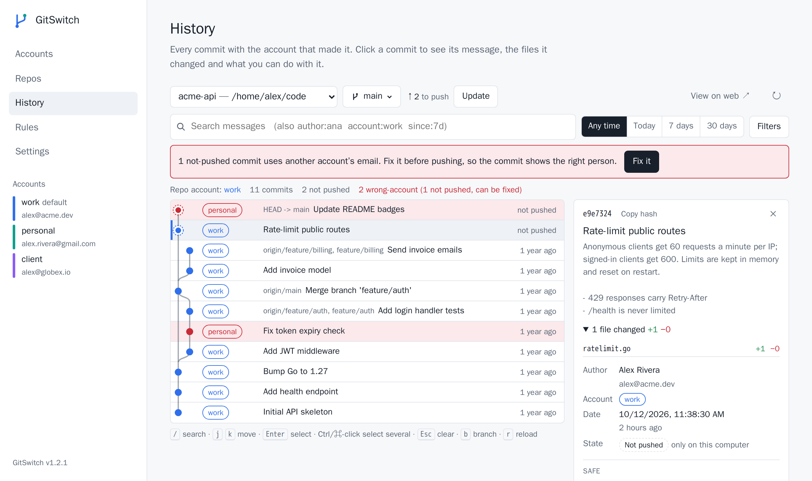
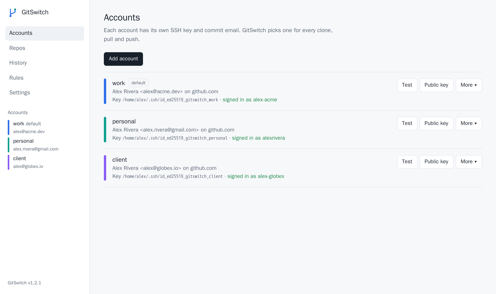
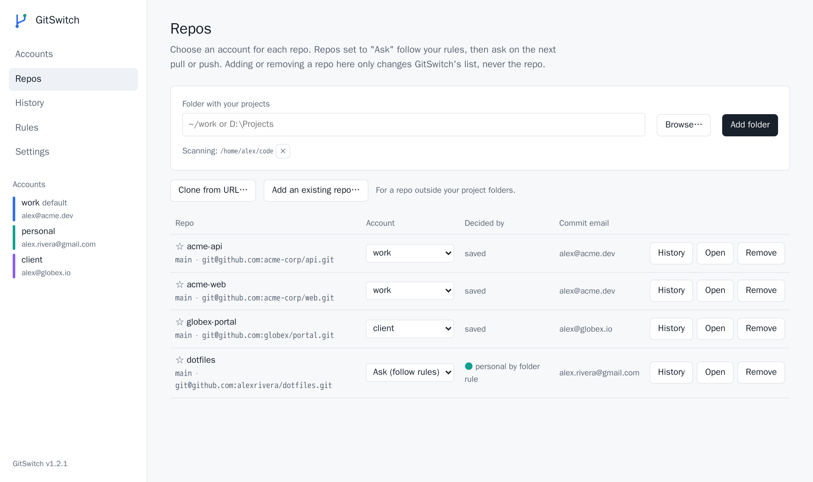
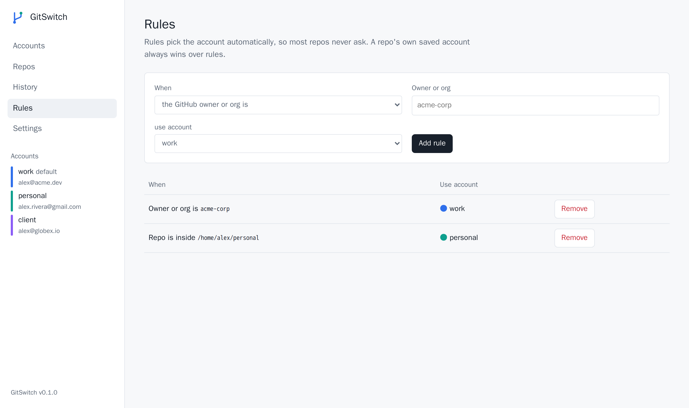
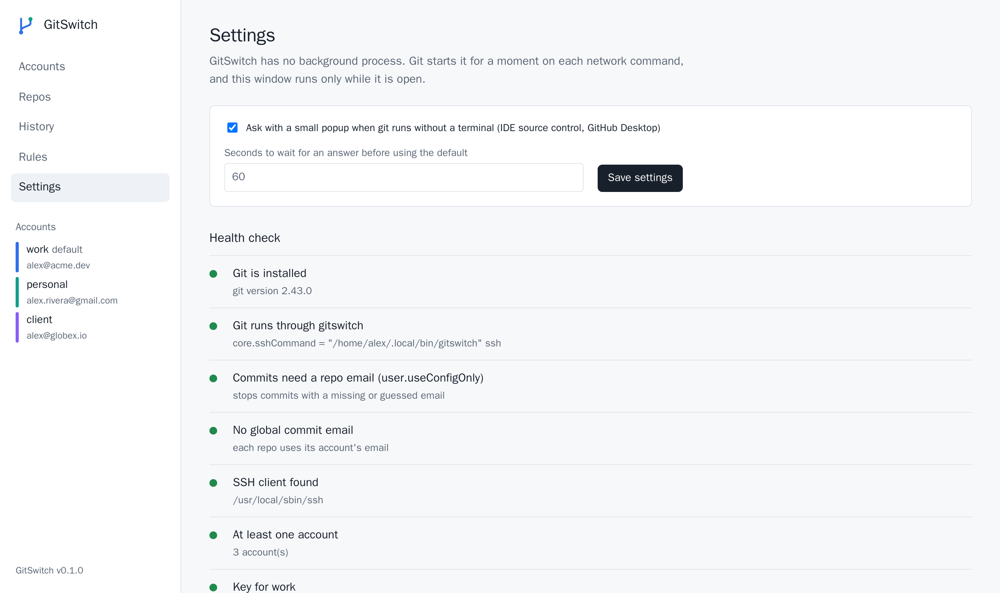

# GitSwitch

[](https://github.com/macdipu/gitswitch/actions/workflows/test.yml)
[](https://github.com/macdipu/gitswitch/releases/latest)
[](go.mod)

[](LICENSE)

**Use several git accounts (work, personal, clients) on one computer with normal clone URLs.**
GitSwitch picks the right SSH key and commit email for every clone, pull and push, in every terminal and IDE.

```
$ git push

Git account for my-company/api?
  1  personal         you@gmail.com
  2  work             you@company.com
Type a number for this time, or add ! to always use it for this repo (e.g. 2!): 2!
gitswitch: work saved for this repo
```

- **One-time install.** One command installs the terminal program and the desktop app on Windows, macOS and Linux. Keeps working after restarts and updates.
- **Nothing running in the background.** Git starts GitSwitch for a moment on each network command (a few milliseconds and about 6 MB of memory, measured on Linux), then it exits.
- **Two front ends, same settings:** a terminal app (`gitswitch`) and a desktop app (`gitswitch ui`).
- **History you can act on:** the account behind every commit, its full message and changed files; revert, drop, roll back and cherry-pick with each step explained; switch branches and pull; search by message, author, account or date. Pushed history is never rewritten.
- **Works everywhere git runs:** Windows Terminal, PowerShell, cmd, macOS Terminal, iTerm, VS Code, Android Studio and other JetBrains IDEs, GitHub Desktop, SourceTree.

<picture>
  <source media="(prefers-color-scheme: dark)" srcset="docs/images/web-history-dark.png">
  
</picture>

## Contents

- [Install](#install)
- [Quick start](#quick-start)
- [How an account is chosen](#how-an-account-is-chosen)
- [Terminal app and desktop app](#terminal-app-and-desktop-app)
- [IDE notes](#ide-notes)
- [Commit history and branches](#commit-history-and-branches)
- [Repo list](#repo-list)
- [Health check](#health-check)
- [Command reference](#command-reference)
- [How it works](#how-it-works)
- [Uninstall](#uninstall)
- [Development](#development)
- [License](#license)

## Install

The installer detects your system, downloads the matching programs (`gitswitch` and the desktop app) from the [latest release](https://github.com/macdipu/gitswitch/releases/latest), verifies their SHA-256 checksums, checks that they start on your system and installs them. On Linux without WebKitGTK it installs only `gitswitch` (see [Terminal app and desktop app](#terminal-app-and-desktop-app)).

**macOS, Linux, WSL, Git Bash**

```sh
curl -fsSL https://raw.githubusercontent.com/macdipu/gitswitch/main/install.sh | sh
```

**Windows (PowerShell)**

```powershell
irm https://raw.githubusercontent.com/macdipu/gitswitch/main/install.ps1 | iex
```

Run the same line again to update. To pin a version, set `GITSWITCH_VERSION=v1.2.0` first.

<details>
<summary>Manual install</summary>

Download `gitswitch-<os>-<cpu>` and, for the desktop app, `gitswitch-app-<os>-<cpu>` for your computer from the [Releases page](https://github.com/macdipu/gitswitch/releases). Rename them to `gitswitch` and `gitswitch-app` (add `.exe` on Windows), put both in one folder and run `gitswitch install`: it installs both. On Windows you can simply double-click `gitswitch.exe`. Run with no command in a terminal, it asks before it connects to git.

</details>

<details>
<summary>With Go</summary>

```sh
go install github.com/macdipu/gitswitch/cmd/gitswitch@latest
gitswitch install
```

This installs the terminal program only. The desktop app needs cgo and build tags; see [Development](#development).

</details>

Then open a **new** terminal.

## Quick start

New to SSH keys? Open the desktop app:

```sh
gitswitch ui
```

The first time, a guided setup connects git, adds your first account, creates its key, shows where to put the key on GitHub, GitLab or Bitbucket, tests the login and asks for your projects folder. If something goes wrong it explains why. Run it again any time from Settings → **Run guided setup**. The terminal app (`gitswitch`) shows the same steps as keys to press when there is no account yet.

Or, in the terminal, answer a few questions:

```sh
gitswitch setup
```

<p align="center"></p>

The wizard connects GitSwitch to git, then for each account:

1. Asks for a short name, the commit name and email.
2. Creates a new SSH key (or uses one you already have) and shows the public key with a link to GitHub's **New SSH key** page.
3. Waits while you add the key, then logs in to check it (`Connected: work is alex-acme on github.com`).
4. Lets you add rules, so most repos never need to ask, and optionally pick a default account (type `none`, or press Enter to keep none).
5. Asks for the folder where you keep your projects, so the apps can list your repos.

Or script it, one command per account:

```sh
gitswitch account add work --email you@company.com --name "Your Name" --key new
gitswitch account add personal --email you@gmail.com --key new
gitswitch key show work --open        # copies the public key, opens GitHub's SSH key page
gitswitch test                        # checks each key logs in, and as whom
gitswitch rule add owner:my-company work
gitswitch rule add folder:~/personal personal
```

Add each public key on GitHub (**Settings → SSH and GPG keys → New SSH key**) while signed in to the matching account.

From then on, clone and push as usual:

```sh
git clone git@github.com:owner/repo.git
```

## How an account is chosen

For each repo, GitSwitch checks in this order and uses the first match:

1. The account saved for the repo (`gitswitch use work`, or ticked when asked). `gitswitch repo clone --account` saves it for the new repo.
2. An **owner rule**: `owner:my-company` matches every repo of that org, even during `git clone`.
3. A **folder rule**: `folder:~/work`.
4. In a terminal, it **asks**. A typo asks again. When git runs several connections at once (`fetch --jobs`, submodules), they ask one at a time.
5. With no terminal (e.g. an IDE's Source Control panel, a background job, or `GIT_TERMINAL_PROMPT=0`), a **small popup** asks.
6. If nobody answers: the **default account**, when you have set one, for that connection only. With no default, git does not connect, so nothing is ever pushed as a guessed account. Nothing hangs waiting for an answer, and ssh's `BatchMode=yes` never asks.

**The default account is optional.** An answer is used for that connection only; it is saved for the repo only when you tick **always use it for this repo** in the popup, or add `!` in a terminal (`2!`). Without a default (the normal case), Enter alone is not an answer. With one, Enter picks it.

| | Set | Remove |
| --- | --- | --- |
| Global default | `gitswitch default work`, or Accounts → "When a repo has no account yet" | `gitswitch default --none` (repos with nothing saved ask) |
| One repo | `gitswitch use work`, or the Repos page | `gitswitch forget` (follow rules and the default again) |
| One repo, always ask | `gitswitch use --ask`, or "Ask every time" on the Repos page | `gitswitch forget` |

It also sets the repo's `user.name` and `user.email` to the chosen account. A default used because nobody answered is for that connection only: it is not saved, and the repo's commit email is left alone.

If your git config cannot be read (for example a typo in `~/.gitconfig`), GitSwitch stops the connection with an error rather than guess a key.

## Terminal app and desktop app

Both edit the same settings. A change in one shows up in the other.

**Terminal app** (`gitswitch`)

<p align="center"></p>

**Desktop app** (`gitswitch ui`), a native window, light and dark to match your system:

<picture>
  <source media="(prefers-color-scheme: dark)" srcset="docs/images/web-accounts-dark.png">
  
</picture>

<details>
<summary>More desktop app pages</summary>

**Repos:** the account for each repo, and what decided it.

<picture>
  <source media="(prefers-color-scheme: dark)" srcset="docs/images/web-repos-dark.png">
  
</picture>

**Rules**

<picture>
  <source media="(prefers-color-scheme: dark)" srcset="docs/images/web-rules-dark.png">
  
</picture>

**Settings and health check**

<picture>
  <source media="(prefers-color-scheme: dark)" srcset="docs/images/web-settings-dark.png">
  
</picture>

</details>

| | Terminal app | Desktop app |
| --- | --- | --- |
| Open | `gitswitch` (or `gitswitch tui`) | `gitswitch ui`, or GitSwitch in the Start / app menu |
| Best for | IDE terminals, SSH sessions, WSL, servers | Mouse users, the visual history graph and commit actions |
| Pages | Accounts, Repos, History, Rules, Settings | Accounts, Repos, History, Rules, Settings |
| Runs in | the terminal | the system web view (WebView2, WebKit, WebKitGTK) |
| Closes | press `q` | close the window |

The terminal program (`gitswitch`) and the desktop app (`gitswitch-app`) are two files, installed together. Git only ever runs `gitswitch`, which is small and has no window code, so the desktop app never slows down a clone, pull or push.

On Linux the desktop app needs WebKitGTK 4.1 (`libwebkit2gtk-4.1-0` on Debian and Ubuntu, `webkit2gtk4.1` on Fedora). The installer skips the app when WebKitGTK is missing or the app does not start, so servers need nothing extra; install WebKitGTK and run the installer again to add it. The desktop app runs on Ubuntu 22.04 and newer, and other systems with glibc 2.35 or newer. `GITSWITCH_CLI_ONLY=1` installs only the terminal program.

<details>
<summary>Terminal app keys</summary>

`1`–`5` or Tab switch pages, ↑↓ move, `?` shows all keys, `q` or Ctrl+C quits. Esc closes a form or pop-up, but never quits.

| Page | Keys |
| --- | --- |
| Accounts | `a` add · `e` edit · `R` rename · `t` test login · `k` public key (`c` copy, `o` open GitHub page) · `K` use another key · `d` make default (on the default: remove it) · `p` load passphrase into agent · `x` remove (then `y` keeps the key files, `D` deletes them too) |
| Repos | Enter choose account (or follow rules and default, or ask every time) · `h` history · `c` clone by URL · `f` add projects folder · `a` add one repo · `p` pin · `o` open folder · `O` open in editor · `x` remove from list · `r` rescan |
| History | Enter commit details · `m` load more · `/` filter · `b` switch branch · `u` update · on a commit: `v` revert · `d` drop · `z` roll back · `c` cherry-pick (Space marks several) · `w` view on the web · `o` other repo · `f` only wrong-account commits · `x` fix not-pushed commits · `r` reload |
| Rules | `a` add · `x` remove |
| Settings | Enter toggles an option or fixes a failed check · `r` runs the health checks again |

Questions answer only to the keys they name; `n` or Esc cancels. Lists that pop up (branch, repo, key) filter as you type, so letters go into the filter there. When git or ssh fails with an error GitSwitch knows, a "What went wrong" panel explains it, with git's own message below.

When the terminal app creates a key or tests a login, it steps aside so `ssh-keygen` and `ssh` can ask for your passphrase, then comes back.

</details>

## IDE notes

- **VS Code:** nothing to set. The integrated terminal prompts; the Source Control panel uses the repo's saved account, rules, the popup, or your default if you set one.
- **Android Studio / IntelliJ / other JetBrains IDEs:** if your version has **Settings → Version Control → Git → SSH executable**, choose **Native**. The Built-in option ignores git's settings.
- **Key passphrases:** IDEs can't type a passphrase for you. Run `gitswitch key agent <account>` once in a terminal to store it in the OS agent or macOS Keychain.
- **Windows:** the Windows `ssh-agent` service remembers passphrases. `gitswitch doctor` tells you if it is off and how to turn it on (one admin command).
- **WSL:** WSL is a separate Linux system with its own git. Run the install line inside WSL too.

## Commit history and branches

- `gitswitch log` shows the commit graph with the account of each commit, and the current branch.
- `gitswitch log --flagged` lists commits made with another of your accounts.
- `gitswitch fix-author` corrects those that are not pushed yet, on the current branch. Pushed commits are never changed.

Find commits with filters. Text, author and dates search the whole history, not only the latest commits:

```sh
gitswitch log --author ana --since "2 weeks ago"      # author name or email
gitswitch log --grep login --until 2024-06-30         # message; both ends of a date range are included
gitswitch log --account work                          # commits made with one of your accounts
gitswitch log -n 200                                  # more than the latest 40 commits
```

Work with branches and commits, always with the repo's account:

```sh
gitswitch branch                     # current branch, HEAD, what to push and pull, uncommitted files, all branches
gitswitch switch origin/feature-x    # a remote branch becomes a local branch that tracks it
gitswitch update                     # pull, fast-forward only; never a surprise merge commit
gitswitch revert 1a2b3c4             # a new commit that undoes one (safe after pushing)
gitswitch cherry-pick 5d6e7f8 9a0b1c2   # copy commits from another branch, oldest first
gitswitch drop 1a2b3c4               # remove a not-pushed commit
gitswitch rollback 1a2b3c4           # undo the not-pushed commits after it; their changes stay in your files
gitswitch show 1a2b3c4               # the whole message and the files it changed
gitswitch browse 1a2b3c4             # open the commit on GitHub, GitLab, Bitbucket, ...
gitswitch undo                       # undo the last switch, revert, drop, rollback, cherry-pick or fix-author
```

**Undo.** The last change GitSwitch made in a repo can be undone once: `gitswitch undo` says what it will do and asks (`-y` to skip, `--show` to only look, `--show --json` for scripts). The desktop app offers **Undo** in the message after each change and in the History toolbar, and the terminal app uses `U`. Undo puts the branch back exactly as it was. After a rollback only the branch moves, so files you edited since are kept. It refuses, and changes nothing, when undoing would lose work: new commits or a pull since, commits that are already pushed (revert them instead), or uncommitted changes in files it would change. GitSwitch keeps what it would go back to in `refs/gitswitch/undo` and the repo's `[gitswitch "undo"]` config, so `git gc` doesn't delete a dropped commit while it can still be undone.

`drop` and `rollback` rewrite history, so they only work on commits that are not pushed, and ask first (`-y` to skip). If a revert, drop or cherry-pick does not apply cleanly, it is aborted and nothing changes. If your uncommitted changes clash with the new history, git keeps them in the stash and GitSwitch tells you how to get them back.

`drop`, `rollback` and `fix-author` refuse when the branch pushes to a remote branch this clone has no copy of (a single-branch clone, or a branch deleted on the server), since they can't tell what is pushed; `update` explains the same case. `fix-author` also refuses when a merge brought pushed commits in after your first not-pushed one: run `git pull --rebase` first. `switch upstream/main` is refused while your local `main` pulls from `origin/main`; it tells you how to make a separate branch. `browse` only opens commits that are on a remote branch. The stash is not shown as history.

The apps' History page has all of this, and the desktop app's toolbar says when the remote branch is missing from the clone. In the desktop app, click a commit to see its full message, the files it changed and what you can do with it (each action explains itself), Ctrl/⌘-click several to cherry-pick them, and search with words or tokens like `author:ana since:7d`. Keys: `/` search, `j`/`k` move, `b` branch, `Shift+U` undo, `Esc` clear. In the terminal app, Enter shows a commit's message and files. Both apps show the latest 300–400 commits first, with "Load more" (`m` in the terminal app) for older ones.

## Repo list

The Repos page in both apps, and `gitswitch repo`, show one shared list: repos found in your project folders plus repos you add by hand.

```sh
gitswitch repo clone git@github.com:acme/api.git --account work   # clone as work from the first download
gitswitch repo add ~/code/side-project   # an existing repo outside your project folders
gitswitch repo list                      # * pinned, + added by hand, ! folder gone
gitswitch repo show                      # folder, branch, remotes, account (--json too)
gitswitch repo pin                       # keep the current repo at the top
gitswitch repo open --editor             # open in your editor (gitswitch set editor code)
gitswitch repo remove ~/code/old-thing   # take it off the list
```

`repo clone` saves the account in the new repo before git downloads anything, so the right key is used from the start and the repo gets that account's name and email. Without `--account`, your rules decide, then GitSwitch asks as usual. The desktop app has the same as "Clone from URL…", with progress, and the terminal app has it on the Repos page (`c`).

Adding or removing a repo changes only GitSwitch's list. The repo's files, remotes, branches and git settings are never touched. In the desktop app, "Add an existing repo…" uses the system folder picker.

## Health check

`gitswitch doctor` finds anything that can make git skip GitSwitch or log in as the wrong account; `gitswitch doctor --fix` repairs what it can:

- `GIT_SSH_COMMAND` or `GIT_SSH` set in your environment or shell profile (git then ignores GitSwitch)
- repos with their own `core.sshCommand` (left by other tools)
- `~/.ssh/config` blocks that add other keys for your git hosts
- host keys not yet recorded (a first push from an IDE would fail)
- Windows ssh-agent service off, missing key files, a global commit email
- whether the desktop app is installed (for information; servers don't need it)

In the apps, the checks run when you open Settings (`r` runs them again in the terminal app).

When git or ssh fails with a common error (key not added on the host, unknown host key, no access to the repo, push rejected, and so on), the CLI, the terminal app and the desktop app say what happened and what to do, with git's own message kept below. In the desktop app, errors stay until you close them, and a failed login test or clone explains itself.

## Command reference

Run `gitswitch help` for details. Add `--dry-run` to any command to see what it would change without changing anything.

| Area | Commands |
| --- | --- |
| Setup | `install`, `setup`, `uninstall [--purge]` |
| Apps | `tui`, `ui` |
| Accounts | `account add\|edit\|list\|remove [--delete-keys]\|rename`, `default <id>\|--none`, `test` |
| Keys | `key new\|show\|pick\|agent` |
| Repos | `use <id>\|--ask`, `forget`, `status`, `repo list\|clone\|add\|remove\|show\|open\|pin\|unpin` |
| Rules | `rule add\|list`, `rule remove owner:<org>\|folder:<path>\|<n>` |
| History | `log [-n N] [--author\|--grep\|--since\|--until\|--account]`, `show`, `fix-author`, `revert`, `drop`, `rollback`, `cherry-pick`, `undo`, `browse` |
| Branches | `branch`, `switch`, `update` |
| Diagnostics | `doctor [--fix]` |
| Settings | `set gui-prompt on\|off`, `set prompt-timeout <s>`, `set editor <command>` |
| Shell | `completions bash\|zsh\|fish\|powershell` |

### Shell completions

Completions include your account names.

```sh
eval "$(gitswitch completions bash)"                                   # ~/.bashrc
eval "$(gitswitch completions zsh)"                                    # ~/.zshrc
gitswitch completions fish > ~/.config/fish/completions/gitswitch.fish
```

```powershell
gitswitch completions powershell | Out-String | Invoke-Expression      # $PROFILE
```

## How it works

`gitswitch install` does this once:

- Copies itself to a fixed folder (`%LOCALAPPDATA%\GitSwitch` on Windows, `~/.local/bin` on macOS and Linux) and adds it to your PATH.
- Installs the desktop app when it came with the download: next to `gitswitch` on Windows and Linux (with a Start menu or app menu entry), as `~/Applications/GitSwitch.app` on macOS.
- Sets git's global `core.sshCommand` to GitSwitch. Every program that runs git reads this setting, which is why it works in every terminal and IDE without per-app setup.
- Sets `user.useConfigOnly = true` and moves your global `user.email` aside, so a commit can never silently use the wrong email.

All settings live in git config, so the terminal, the desktop app and git always agree:

| Scope | File | Keys |
| --- | --- | --- |
| Global | `~/.gitconfig` | `gitswitch-account.<id>.*`, `gitswitch.default` (only if you set one), `gitswitch.rule`, `gitswitch.guiPrompt`, `gitswitch.promptTimeout`, `gitswitch.scanFolder`, `gitswitch.repo`, `gitswitch.hideRepo`, `gitswitch.pin`, `gitswitch.editor` |
| Per repo | `.git/config` | `gitswitch.account` (an account, or `ask` for ask every time) |

**Security:** GitSwitch never stores passphrases or tokens. Keys made without a terminal (for example in the desktop app) are created inside GitSwitch, so the passphrase never appears on a command line. The desktop app serves its page inside the process: it opens no network port.

See [ARCHITECTURE.md](ARCHITECTURE.md) for how the code is organised.

## Uninstall

```sh
gitswitch uninstall           # restores your previous git settings and removes the desktop app
gitswitch uninstall --purge   # also deletes your saved accounts
```

## Development

Requires Go 1.25 or newer. The desktop app uses [Wails](https://wails.io) and needs cgo on macOS and Linux (Linux: `libgtk-3-dev libwebkit2gtk-4.1-dev`).

```sh
CGO_ENABLED=0 go build -o gitswitch ./cmd/gitswitch                                  # git hook, CLI, terminal app
go build -tags desktop,production -o gitswitch-app ./cmd/gitswitch-app             # desktop app (macOS, Windows)
go build -tags desktop,production,webkit2_41 -o gitswitch-app ./cmd/gitswitch-app  # desktop app (Linux)
go test ./...
./build.sh v1.0.0             # every target this machine can build + SHA256SUMS into dist/
```

Put `gitswitch-app` next to `gitswitch` and `gitswitch ui` opens it. Releases build the desktop app for macOS and Linux on their own runners, since it needs cgo there. Linux builds on Ubuntu 22.04, so the app also starts on older systems (see `.github/workflows/release.yml`).

### Architecture

The code is organised by feature (`internal/features/<feature>/{domain,application,infrastructure}`). All three front ends call the same application use cases. The use cases depend only on interfaces declared in the domain, and infrastructure (git, ssh, the file system) implements those interfaces:

```text
CLI ─────┐
TUI ─────┼──> Application Use Cases ──> Domain Interfaces
Desktop ─┘                                  ▲
                                            │
                              Infrastructure Implementations
```

`internal/bootstrap` connects the implementations to the use cases. `test/architecture` fails the build when an import breaks these rules. See [ARCHITECTURE.md](ARCHITECTURE.md) for the details.

The tests build the real binary and run real `git clone`, `pull` and `push` through it against local repos (no network). They cover install and uninstall, every way an account is chosen, clones inside other repos, submodules, port-443 hosts, renames, duplicate keys, dry runs, health checks, history and author fixes, the desktop app's API, and the terminal prompt. [GitHub Actions](https://github.com/macdipu/gitswitch/actions) runs them on Linux, macOS and Windows for every push.

Contributions are welcome. See [CONTRIBUTING.md](CONTRIBUTING.md), and [ROADMAP.md](ROADMAP.md) for planned features you can pick up.

## License

[MIT](LICENSE)
